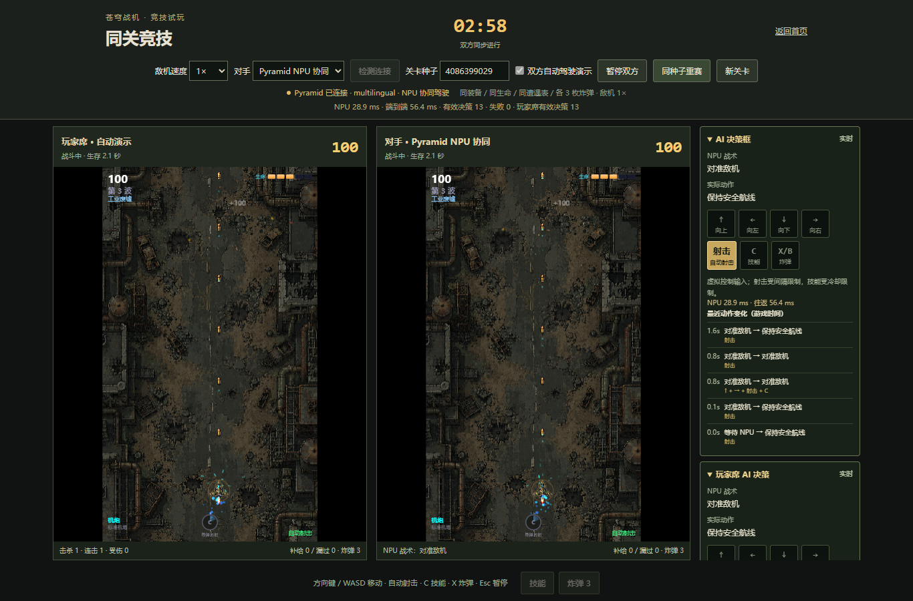

# 苍穹战机 · AI Pyramid

中文像素末世风纵向射击游戏，支持手动驾驶、同关比成绩和 M5Stack AI Pyramid 的 NPU 协同驾驶。

基于 [phaethix/polished-arcade-shooter](https://github.com/phaethix/polished-arcade-shooter) 修改，保留原作者 MIT 许可与 Git 历史，原说明见 [README.upstream.md](README.upstream.md)。设备推理使用 [AXERA-TECH/laya-axera](https://github.com/AXERA-TECH/laya-axera)，固定源码提交 `0e6e5398dc7b5977325f713621437c373d4695ef`。



## 功能

- 中文界面，像素末世风自机、敌机、Boss、子弹、补给、场景及特效。
- 个人关卡自动驾驶，可切回手动、暂停、返回首页。
- 180 秒同关竞技：相同种子、装备、生命与关卡时钟，独立战场比成绩。
- 敌机移动速度 0.5× / 1× / 1.5× / 2× / 3×，开局选择，双方同档；子弹等保持原速。
- 补给拦截预测和本地拾取辅助，散弹按实际射程调整攻击站位。
- AI 决策框：NPU 战术、本地动作、虚拟按键、最近动作变化与推理耗时。
- 故障时本地规则接管，结算标记“混合练习”；AI 演示不写入普通金币、成就和高分。

## 电脑试玩

需要 Node.js 24 与 npm，无设备也能玩手动与本地规则 AI。

```bash
npm ci
npm run dev
```

打开终端给出的地址，首页右上角进入同关竞技。

## 连接 Pyramid

电脑另需 Python 3.10 或以上，设备与电脑的局域网互通。先启动设备 Laya 服务，再运行：

```bash
npm run build
python pyramid_bridge.py --dist dist --pyramid http://192.168.1.100:8010
```

示例 IP 改成你的设备地址。竞技地址为 `http://127.0.0.1:8854/?pyramid=1#race`，个人关卡为 `http://127.0.0.1:8854/?pyramid=1`。

Windows 启动器：

```powershell
powershell.exe -NoProfile -ExecutionPolicy Bypass -File .\start-pyramid.ps1 -PyramidIP 设备IP
```

### 设备部署

`pyramid-install.py` 在具备 AXEngine 驱动的 Pyramid 上建立 `/root/sky-blaster-pyramid` 独立环境，下载模型、启动局域网 8010 服务并验证 NPU。约需 2 GiB 可用存储及联网下载。模型不包含在仓库中。

Windows 通过 SSH 部署：

```powershell
powershell.exe -NoProfile -ExecutionPolicy Bypass -File .\pyramid-install.ps1 -PyramidIP 设备IP
```

密码在终端中输入。设备重启后，需要在 SSH 中重启服务：

```bash
cd /root/sky-blaster-pyramid
.venv/bin/laya-axera serve --model multilingual=models/Laya/multilingual --host 0.0.0.0 --port 8010 --provider AxEngineExecutionProvider
```

设备服务用于可信局域网，电脑桥接仅监听 `127.0.0.1`。画面和实时物理在电脑执行，NPU 异步选择“躲避、攻击、补给、保持”，本地算法执行移动、避弹与普通按键约束。输入是结构化游戏状态，推理耗时不是摄像头识别耗时。

## 验证

```bash
npm run typecheck
npm run lint
npm run format:check
npm run test:run
npm run build
python -m unittest test_pyramid_bridge.py
```

当前游戏回归为 279 项测试。实际 Pyramid 已验证完整三分钟竞技、补给拾取、散弹命中、死亡画面稳定、暂停取消请求与决策框。示例设备推理约 29 ms，电脑往返约 57 ms；这是单台设备样例，不代表所有场景性能或稳定胜率。

更多：[Pyramid 说明](README.Pyramid.zh-CN.md)、[竞技说明](README.竞技.zh-CN.md)、[V2 说明](README.V2.zh-CN.md)。

## 来源与许可

原游戏的 MIT 许可与作者声明保留在 [LICENSE](LICENSE)，本次代码改动按 MIT 发布。Laya 源码独立安装，Apache-2.0 许可与 NOTICE 保存在 [licenses](licenses)。模型按其发布页条款使用，不随仓库分发。

V2 图片由项目维护者使用生成式图像工具生成并提供，运行所需 26 张图片按本仓库 MIT 许可提供。来源与 SHA-256 见 `public/art-v2/sources.json`；未使用商业游戏原始素材。
