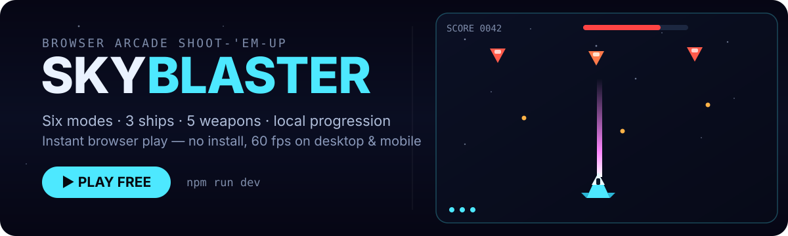

<p align="center">
  
</p>

<p align="center">
  <a href="https://github.com/phaethix/polished-arcade-shooter/actions/workflows/ci.yml"></a>
  <a href="https://github.com/phaethix/polished-arcade-shooter/actions/workflows/pages.yml"></a>
  <a href="https://github.com/phaethix/polished-arcade-shooter/releases"></a>
  <a href="LICENSE"></a>
  
</p>

<p align="center">
  <a href="https://phaethix.github.io/polished-arcade-shooter/"><strong>▶ Play online</strong></a>
  · <a href="docs/PLAYER_GUIDE.md">Player guide</a>
  · <a href="https://github.com/phaethix/polished-arcade-shooter/issues/new?template=bug_report.yml">Report a bug</a>
  · <a href="https://github.com/phaethix/polished-arcade-shooter/issues/new?template=feature_request.yml">Request a feature</a>
</p>

No install required for the live demo. Runs at 60 fps on desktop and mobile (keyboard or touch).

---

## What it is

**Sky Blaster** (`polished-arcade-shooter`) is an open-source vertical shoot-'em-up you can play instantly in the browser, or build and run locally. It ships as a single static page on GitHub Pages — no backend, no asset downloads, with offline-capable progression saved in `localStorage`.

A thin React + TypeScript shell hosts a fixed-timestep Canvas 2D game loop, with procedural Web Audio for all sound effects.

### Modes

<p align="center">
  
</p>

| Mode              | What you do                                           |
| ----------------- | ----------------------------------------------------- |
| **Story**         | Campaign across 4 chapters with environmental hazards |
| **Endless**       | Survive escalating waves for a high score             |
| **Boss Rush**     | Pure boss encounters                                  |
| **Daily**         | One seeded run, identical for every player            |
| **Practice**      | Learn the ropes with invincibility on (`I`)           |
| **Co-op Endless** | 2P online — host (`H`) + guest (`J`), 60 Hz sync      |

### Features

- **Loadout depth** — 3 aircraft with active skills and 5 weapons, each with its own firing pattern.
- **Local meta progression** — coins, unlocks, 6 achievements, and a top-10 local leaderboard persist between sessions.
- **Procedural audio** — every laser, explosion, and power-up is synthesized live with the Web Audio API; nothing is downloaded.
- **Frame-accurate netcode** — Co-op Endless runs 60 Hz snapshots with guest-side prediction and reconciliation.

---

## How to play

1. Open the **[live demo](https://phaethix.github.io/polished-arcade-shooter/)** or run `npm run dev`.
2. On the title screen, choose **mode**, **aircraft**, **weapon**, and **difficulty**.
3. **Move** with WASD / arrows (or drag on touch). **Shoot** with Space / Z (`F` toggles auto-fire; touch auto-fires while held).
4. Survive waves and bosses with **bombs** (`X`/`B`), **skills** (`C`/`Shift`), and power-ups. In Practice, `I` toggles invincibility.

Full controls, enemy tables, and scoring rules: **[docs/PLAYER_GUIDE.md](docs/PLAYER_GUIDE.md)**.

---

## Quick start

### Prerequisites

- [Node.js](https://nodejs.org/) 18 or newer (CI uses Node 24)
- npm

### Run locally

```bash
git clone https://github.com/phaethix/polished-arcade-shooter.git
cd polished-arcade-shooter
npm install
npm run dev
```

Open the URL printed by Vite (typically `http://localhost:5173`).

### Co-op Endless (local)

Solo modes need only Vite. Co-op also needs a room server (Cloudflare Workers + Durable Objects, via `partyserver`) in a second terminal:

```bash
# Terminal 1 — room server relay (default localhost:8787)
npm run party:dev

# Terminal 2 — game client
cp .env.example .env   # optional; defaults to localhost:8787
VITE_PARTYKIT_HOST=localhost:8787 npm run dev
```

Open two browser windows, select **Co-op Endless**, host with `H`, join with `J`, type the room code, press Enter, then the host presses Space when both are in the lobby. See [PLAYER_GUIDE.md](docs/PLAYER_GUIDE.md#co-op-endless).

**Deploy room server:** `npm run party:deploy` (Cloudflare Workers → `*.workers.dev`). Pass the client origin so the worker allows cross-origin WebSocket handshakes:

```bash
npx wrangler deploy --var PARTYKIT_HOST:https://phaethix.github.io
```

Set `VITE_PARTYKIT_HOST` to the deployed `*.workers.dev` host for production builds (GitHub Pages env or `.env` at build time). The static game on Pages stays separate; only co-op clients open a WebSocket. Requires a Cloudflare account; authenticate once with `npx wrangler login`.

---

## Documentation

| Document                                              | Description                               |
| ----------------------------------------------------- | ----------------------------------------- |
| [PLAYER_GUIDE.md](docs/PLAYER_GUIDE.md)               | Controls, modes, enemies, scoring         |
| [WHITEPAPER.md](docs/WHITEPAPER.md)                   | Product vision, systems, release history  |
| [ARCHITECTURE.md](docs/ARCHITECTURE.md)               | Source layout and module responsibilities |
| [GIT_CONVENTIONS.md](docs/GIT_CONVENTIONS.md)         | Branch naming and commit format           |
| [CONTRIBUTING.md](CONTRIBUTING.md)                    | Setup, testing, and pull request workflow |
| [2026-07-07-roadmap.md](.issue/2026-07-07-roadmap.md) | Expansion phases and backlog              |

---

## Contributing

Contributions are welcome. Read [CONTRIBUTING.md](CONTRIBUTING.md) for the build, test, and pull-request workflow, and [ARCHITECTURE.md](docs/ARCHITECTURE.md) for the source layout. This repository follows the [GitHub community standards](https://github.com/phaethix/polished-arcade-shooter/community).

1. Read [CONTRIBUTING.md](CONTRIBUTING.md) and [docs/GIT_CONVENTIONS.md](docs/GIT_CONVENTIONS.md).
2. Fork the repo and create a branch (`feature/…`, `fix/…`, `docs/…`, etc.).
3. Use [Conventional Commits](https://www.conventionalcommits.org/) for commit messages.
4. Open a pull request using the [PR template](.github/PULL_REQUEST_TEMPLATE.md).
5. Ensure CI passes (`typecheck`, `lint`, `format:check`, `test:run`, `build`).

| Resource         | Link                                                                                                     |
| ---------------- | -------------------------------------------------------------------------------------------------------- |
| Bug reports      | [New issue](https://github.com/phaethix/polished-arcade-shooter/issues/new?template=bug_report.yml)      |
| Feature requests | [New issue](https://github.com/phaethix/polished-arcade-shooter/issues/new?template=feature_request.yml) |
| Questions        | [GitHub Discussions](https://github.com/phaethix/polished-arcade-shooter/discussions)                    |
| Security         | [SECURITY.md](SECURITY.md)                                                                               |
| Code of conduct  | [CODE_OF_CONDUCT.md](CODE_OF_CONDUCT.md)                                                                 |

---

## License

This project is licensed under the [MIT License](LICENSE).

---

Inspired by classic vertical shooters including _Raiden_, _1942_, and _Touhou_.
